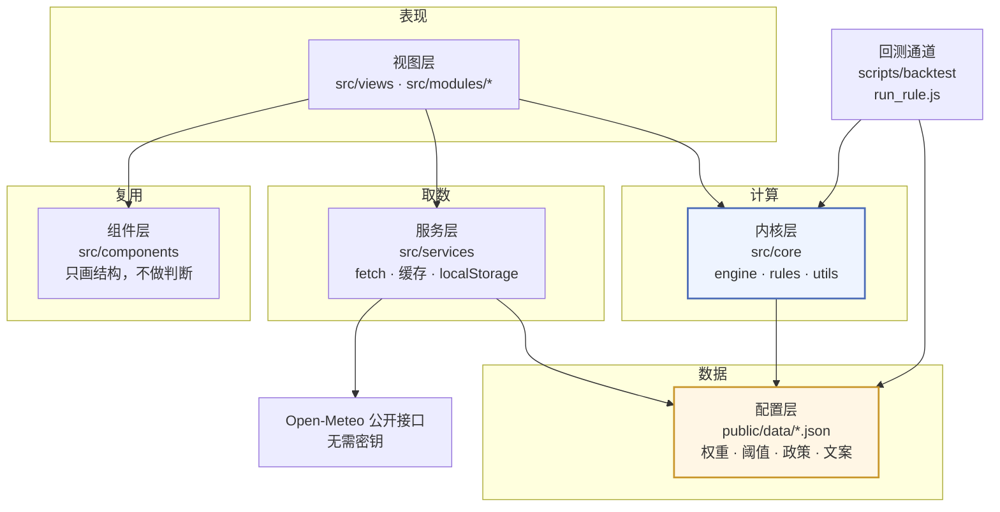
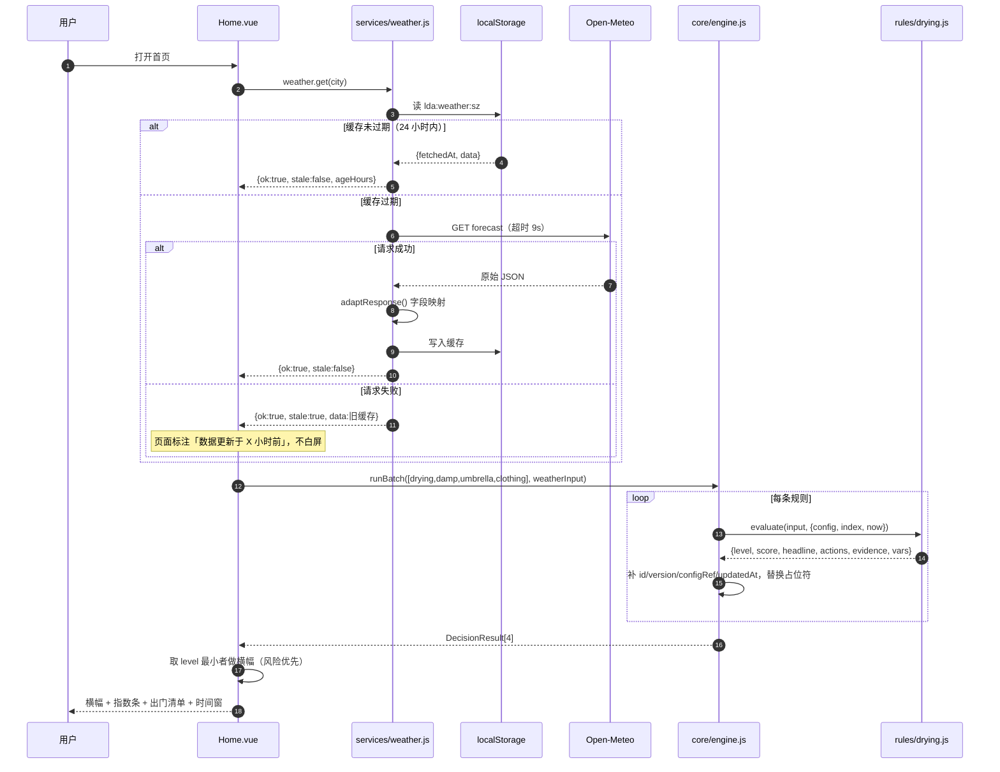
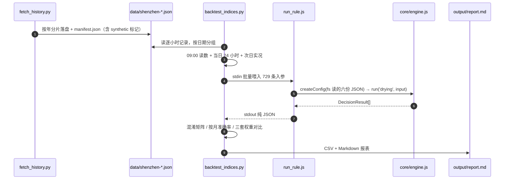

# 生活决策助手 · 软件设计说明书

> 版本 v1.0　编写日期 2026-11-02　对应代码状态：M1 骨架 + 四个模块规则已接入
>
> 本文档按《生活决策助手项目工作指导书 v1.1》1.4「软件设计说明书一份，含架构图、数据契约、测试记录」编写。
> 接口定义的唯一标准是 `docs/CONTRACTS.md`；本文档描述的是**实现**，两者冲突时以 `CONTRACTS.md` 为准并立即修订本文。
> 关键技术取舍的理由见 `docs/decisions/0001-关键技术决策.md`，本文不重复论证，只引用结论。

---

## 一、项目定位与三条硬约束

### 1.1 一句话定位

把"规则复杂、普通人懒得算"的日常问题，做成**一句话结论加一份可执行清单**。

输出形态统一为一个 JSON 对象 `DecisionResult`：一句结论、若干可勾选动作、一份可展开的判定依据。
页面只认这个结构，因此新增一个指数不需要改页面。

### 1.2 三条硬约束

| 编号 | 约束 | 在代码里的体现 | 违反后果 |
|---|---|---|---|
| C1 | 不设后端，纯静态部署 | 全站无服务端代码；`vite build` 产物是静态文件；路由用 hash 模式（决策 5） | 需要运维、需要备案、寒暑假停机即交付失败 |
| C2 | 不采集用户数据 | 只写 `localStorage` 的 `lda:*` 五个键；工资测算只存输入不存身份信息；代码库无真实个人信息 | 一旦上传即构成个人信息收集，合规风险无法自证 |
| C3 | 不碰需登录的校内数据 | 唯一外部依赖是 Open-Meteo 公开气象接口，无需密钥（决策 2） | 账号共享、爬取均违反校规，且无法长期稳定 |

三条约束不是技术偏好。任何"加个后端存一下历史记录""接一下教务系统课表"的提议，直接引用本节否决。

### 1.3 约束推导出的架构要求

C1 + C2 决定了**所有计算必须在浏览器里完成**；而"报告里要评的模型"必须是"线上跑的模型"，
于是又要求计算部分能脱离浏览器运行。这两条合起来，就是第二章的分层与"内核层零依赖"纪律。

---

## 二、总体架构

### 2.1 四层架构图



**依赖只允许自上而下**：

- 视图层可以 import 组件层、服务层、内核层；
- 组件层不 import 任何东西（纯展示，props 进、事件出）；
- 服务层不 import 内核层与视图层（它只负责"取回来、存起来"）；
- 内核层只 import 配置层的**数据**，不 import 服务层、视图层、任何 UI 库，也不调用 `fetch` / `window` / `document` / `localStorage`。

这条纪律由 `eslint.config.js` 的 `no-restricted-globals` 机器拦截，不靠"我记得"。
拦截规则见 `docs/CONTRACTS.md` 第一节。

> 为什么值得这么苛刻：内核层一旦耦合界面，回测就只能另写一套规则，两边结果必然分叉，
> 评审一问"你报告里的准确率是线上那个模型吗"就答不上来。见工作指导书 2.1。

### 2.2 目录结构与职责

```
创新项目/
├── public/data/                  配置层：六份 JSON，谁都不写
│   ├── indices.json              四个指数的权重、归一化区间、等级文案
│   ├── holidays.json             2026 official / 2027 pending
│   ├── tax-rules.json            劳务报酬、工资薪金、年度汇算三段税率
│   ├── clothing-table.json       体感温度 → 穿衣组合映射表
│   ├── cities.json               城市坐标（默认深圳）
│   └── checklists.json           办事清单与采集日期
├── src/
│   ├── core/                     内核层：纯函数，可在 Node 里直接跑
│   │   ├── engine.js             run / runBatch / runAll，补全 DecisionResult
│   │   ├── config.js             createConfig(raw)：Schema 校验 + 深冻结
│   │   ├── rules/                7 条规则：drying damp umbrella clothing holiday salary installment
│   │   └── utils/                normalize dewpoint apparent-temp irr
│   ├── services/                 服务层：config weather storage policy
│   ├── components/               组件层：DecisionCard ScoreBar ActionList FormField TrendChart
│   ├── modules/                  模块内部逻辑：outing / time / money / affairs
│   ├── views/                    Home / Time / Money / Affairs / Settings
│   └── styles/main.css           CSS 变量与工具类
├── scripts/
│   ├── m1-skeleton.mjs           M1 判据：命令行输出合法 DecisionResult
│   ├── experiments/              （预留，当前为空）
│   └── backtest/                 回测通道
│       ├── fetch_history.py      拉取 / 合成逐小时气象数据
│       ├── run_rule.js           Python 调 Node 的唯一入口
│       ├── backtest_indices.py   晾晒指数回测与三套权重对比
│       ├── irr_backtest.py       分期三算法一致性实验
│       ├── requirements.txt      说明"主流程不依赖第三方包"
│       ├── data/                 （.gitignore）历史数据 + manifest.json
│       └── output/               （.gitignore）CSV 与 report.md
├── tests/                        84 条单元用例，node --test
└── docs/                         本说明书、契约、决策记录、进度、数据来源
```

| 层 | 职责 | 允许依赖 | 不允许做的事 |
|---|---|---|---|
| 视图层 | 页面结构、交互、路由 | 组件层、服务层、内核层 | 写业务判断、算分数 |
| 组件层 | 把已有结构画出来 | 无 | 判断"该不该晾"、拼文案 |
| 服务层 | 取数、缓存、本地存储、政策摊平 | 无（可用 fetch / localStorage） | 计算结论、import 内核层 |
| 内核层 | 规则计算，输出结论 | 仅配置层数据 | fetch、DOM、存储、抛异常给页面 |
| 配置层 | 权重、阈值、政策、文案 | 无 | 被任何代码写入 |
| 回测通道 | 数据清洗、批量调用、统计 | 内核层（Node 侧） | 重写一份规则 |

### 2.3 为什么回测要调 Node 而不是用 Python 重写

规则只有一份实现。回测通过 `node scripts/backtest/run_rule.js <ruleId> <input.json>` 进入内核，
Python 只负责数据清洗、批量调用与统计。如果 Python 另写一套公式，"两边迟早分叉"，
而且分叉的过程不会有任何报错——直到答辩现场被问住。工作指导书 2.3 把这条写成了硬要求。

实现上还有一层保险：`run_rule.js` 用 `fs.readFileSync` 读**同样六份 JSON**，
走**同一个 `createConfig()`**，所以校验口径、权重来源、等级文案与浏览器完全一致。

---

## 三、数据契约

契约正文在 `docs/CONTRACTS.md`，本节只列实现侧的字段清单，便于排查与写测试。

### 3.1 DecisionResult 字段表

所有规则函数、所有结论卡、所有回测输出都用这一个结构。

| 字段 | 类型 | 取值域 | 说明 |
|---|---|---|---|
| `id` | string | 与 `indices.json` 键一致 | 规则唯一标识 |
| `version` | string | 如 `1.0.0` | 规则版本，回测报告必须写明用哪一版 |
| `level` | int | 0—4 | 0 最差、4 最佳。返潮反向：3 条条件全中 → 1 |
| `levelLabel` | string | 来自 `levels[].label` | 等级文案 |
| `score` | number | 0—100，保留一位小数 | 连续得分，用于排序与时间窗比较 |
| `headline` | string | 占位符已被引擎替换 | 一句话结论 |
| `actions` | string[] | 可为空 | 可执行动作，渲染成勾选清单 |
| `evidence` | object[] | 可为空 | 判定依据：`{key,label,value,weight,contribution,ratio}` |
| `configRef` | string | `indices.json#<id>` 或 `formula:*` | 指向配置节点，便于排查 |
| `updatedAt` | string | ISO 8601 | 结论生成时间 |
| `degraded` | boolean | 可选 | 数据缺失时的降级标记 |
| `meta` | object | 可选 | 规则私有附加信息（如时间窗、三算法对比） |

约定：

- `evidence[].weight` / `contribution` 为 `null` 表示该项不参与加权（如"最佳时段"）；
- 缺失指标进 `evidence` 时标 `missing: true`，`value` 写"缺失"——不能把"没数据"读成"数据差"；
- `level` 允许 0—4，但配置里的业务最低档是 `level 1`；
  `level 0` 只出现在"待公布""数据不足"这类非业务状态（例如无数据年份的假期倒计时），
  引擎用 `clamp(level, 0, 4)` 兜底。

### 3.2 指数配置 Schema（`indices.json`）

```js
config.indices.drying = {
  type: 'weighted',              // weighted 加权 | rule 数条件 | table 查表
  label: '晾晒指数',
  inputs: ['temp', 'humidity', 'windSpeed', 'precipProb', 'solar'],
  weights: { temp: 0.20, humidity: 0.30, windSpeed: 0.20, precipProb: 0.25, solar: 0.05 },
  normalize: { temp: [10, 32], humidity: [90, 40], windSpeed: [0, 5],
               precipProb: [80, 0], solar: [0, 800] },   // 一律 [劣端, 优端]
  evidenceLabel: { temp: '气温', humidity: '相对湿度', ... },
  format: { temp: '{v} ℃', humidity: '{v}%', ... },
  bestWindow: { windowHours: 2, minScore: 60, horizonHours: 24, collectBefore: '18:00' },
  levels: [{ min: 80, level: 4, label: '适宜', headline: '…{bestWindow}…' }, ...]
}
```

校验规则（`src/core/config.js: validateIndices`，工作指导书 11.2）：

1. `weights` 之和必须为 1，允许 ±0.01；
2. 每项权重必须 > 0；
3. `normalize[key]` 必须是长度为 2 的数组且两端不相等（否则除零）；
4. `levels` 必须按 `min` 严格降序，且必须含 `min: 0` 的兜底档；
5. `weights` 的键必须在 `inputs` 里声明过；
6. `type` 只能是 `weighted` / `rule` / `table`，`rule` 必须有 `thresholds`，`table` 必须有 `tableRef`。

### 3.3 政策配置 Schema

**holidays.json**（决策 3：用 `years` 映射，不用单年平铺）

```js
config.holidays.years['2026'] = {
  status: 'official',            // official | pending | partial
  source, sourceUrl, collectedAt,
  holidays: [{ name: '元旦', start: '2026-01-01', end: '2026-01-03' }],
  makeupWorkdays: ['2026-01-04'],
  schoolTerms: [{ name: '寒假', start, end }]
}
```

当前状态：2026 为 `official`，2027 为 `pending` 且数组为空——**这是合法状态**，
页面显示"待公布"，校验函数对 pending 年份放行空数组。

**tax-rules.json**

```js
{
  meta: { version: '2019-01-01', source: '国家税务总局…公告' },
  serviceIncome:   { threshold: 4000, deduction: { flat: 800, rate: 0.20 }, brackets: [...] },
  salaryIncome:    { basicDeductionMonthly: 5000, brackets: [...] },
  annualSettlement:{ basicDeductionYearly: 60000, brackets: [...] }
}
```

校验：三段都必须存在；`brackets` 必须严格递增；最后一档 `upper` 必须为 `null`。

### 3.4 本地状态键表

键名由 `src/services/storage.js` 统一加前缀 `lda:`，调用方传不带前缀的短名。

| 键 | 内容 | 写入方 | 读取方 | 说明 |
|---|---|---|---|---|
| `lda:settings` | 城市、室内温度、体感偏移 | Settings.vue | 各模块 | 体感校准写这里 |
| `lda:weather` | `{fetchedAt, data}` | services/weather.js | services/weather.js | 24 小时缓存，按城市 id 再分键 |
| `lda:salary` | 最近一次工资测算输入 | Money.vue | Money.vue | 只存输入，不存任何身份信息 |
| `lda:checklist` | 办事清单勾选进度 | ActionList | Affairs.vue | 按清单 id 分组 |
| `lda:feedback` | 体感反馈（日期 + 偏冷/偏热） | DecisionCard | clothing 规则入参 | 最多保留 90 条 |

隐私模式下 `set()` 返回 `false`，页面提示"本次记录不会保存"，不抛异常。

### 3.5 规则入参表

| id | 入参 | 回测是否覆盖 | 备注 |
|---|---|---|---|
| `drying` | `temp, humidity, windSpeed, precipProb, solar, hourly[]` | 是（逐日） | `hourly` 元素同 `weather.js` 的 hourly |
| `damp` | `temp, humidity, windDir, windSpeed, hourly[], pastMinTemp72h, indoorTemp` | 是（逐日，描述性统计） | 缺 `indoorTemp` 时退到 72h 最低气温，再退到 22 ℃ |
| `umbrella` | `precipProb, windSpeed, hourly[]` | 否 | 需要真实降水概率，归档接口没有该字段 |
| `clothing` | `temp, humidity, windSpeed, apparentTemp?, feedbackOffset?` | 否 | 查 `clothing-table.json`，无阈值可调 |
| `holiday` | `year?, today?` | 否 | 纯日历计算，与气象数据无关 |
| `salary` | `gross, mode, months?, specialDeduction?, dayRate?, workDays?` | 否 | 用例在 `tests/salary.test.js` |
| `installment` | `principal, periods, feeRate` | 是（9 组参数 + 5 组边界） | 见 `scripts/backtest/irr_backtest.py` |

---

## 四、数据流

### 4.1 首页加载链路



要点：

- **一次取数、四条规则共用**：`runBatch` 保证天气接口一天只调一次（决策 6）；
- **单条规则失败不影响整体**：`run()` 内部 try/catch，异常与缺配置都转成 `degraded` 结论；
- **降级不静默**：`degraded: true` 或 `stale: true` 必须出现在页面上，否则用户会把旧数据当实时数据。

### 4.2 回测链路



这条链路的唯一"缝"是 `run_rule.js` 的 stdout：一旦日志混进 stdout，Python 的 `json.loads` 立刻报错。
所以 `run_rule.js` 规定 stdout 只放 JSON，所有诊断走 stderr。

---

## 五、四个模块的功能与算法

### 5.1 晾晒指数（`rules/drying.js`，P0）

**输入**：气温、相对湿度、风速、降水概率、日照辐射（五项），可选逐小时序列。

**算法**：五项按 `[劣端, 优端]` 归一化后加权求和。

```
ratio_i = clamp((value_i − poor_i) / (good_i − poor_i), 0, 1)
score   = 100 × Σ w_i × ratio_i
```

`normalize` 写成 `[劣端, 优端]` 而不是 `[min, max]`，于是"湿度越低越好（[90,40]）"与
"风速越大越好（[0,5]）"共用同一个函数，引擎不必为每个指标写方向分支。

**等级**：`levels` 按 `min` 降序查表，`score ≥ 80 → 4（适宜）`，60—80 → 3，40—60 → 2，< 40 → 1。

**最佳时间窗**（`bestWindow()`）：取未来 24 小时逐小时数据，对每个 2 小时滑动窗口求平均晾晒分，
取最高分窗口；最高分低于 `minScore = 60` 时返回 `null`，文案改为"全天不建议"，不硬给时间。

**动作生成**：由 `level` 决定，文案里的 `collectBefore` 来自配置，不在代码里写 `18:00`。

**已知标定问题**：回测显示当前权重与归一化区间下达到 80 分非常困难（见 6.3），
这条结论已写进报告的"口径与已知问题"，是否调整阈值属于产品决策，不在本文档单方面改动配置。

### 5.2 返潮预警（`rules/damp.js`，P0）

不做加权求和，而是**数条件命中条数**，三条同时满足才预警：

| 条件 | 判据 | 阈值来源 |
|---|---|---|
| ① 露点逼近室内表面温度 | `Td ≥ Ti − 1` | `thresholds.dewpointMargin` |
| ② 持续高湿 | 相对湿度 ≥ 85% 且连续 ≥ 6 小时 | `humidityMin` / `humidityHours` |
| ③ 偏南风且风速够 | `windDir ∈ {SE,S,SW,SSE,SSW}` 且 `windSpeed ≥ 2 m/s` | `windDirs` / `windSpeedMin` |

露点用 Magnus 公式（`utils/dewpoint.js`）：

```
α  = ln(RH/100) + a·T/(b+T)
Td = b·α / (a − α)        a = 17.27，b = 237.7
```

`Ti`（室内表面温度）没有实测值，取"设置页手填 → 过去 72 小时最低气温 → 22 ℃ 兜底"三级回退。
**报告与页面必须写明这是近似值**，这是诚实的实验边界。

**等级反向**（决策 4）：命中 3 条 → `level 1`（最差），0 条 → `level 4`。
这样首页横幅只要取 `level` 最小的一条，不需要为返潮写特例；
若写成"命中越多分越高"，横幅会在回南天推荐"今天适合晾晒"——正是最该预警的一天。

### 5.3 体感温度与穿衣（`rules/clothing.js` + `utils/apparent-temp.js`，P1）

Steadman 简化式：

```
e  = RH/100 × 6.105 × exp(17.27T / (237.7 + T))      水汽压 hPa
AT = T + 0.33e − 0.70ws − 4.00                       ws 为 m/s
```

穿衣组合由 `clothing-table.json` 决定（`min` 含、`max` 不含），代码里没有 if-else 分支。
用户点"偏冷/偏热"写入 `lda:feedback`，作为 `feedbackOffset` 叠加到 `AT` 上，下次结论随之调整。

### 5.4 分期真实年化（`rules/installment.js` + `utils/irr.js`，P0）

现金流：期初收本金 `+P`，此后每期支出 `−(P/n + P×feeRate)`，求解

```
NPV(r) = P − Σ_{t=1..n} (P/n + P×feeRate) / (1+r)^t = 0
月利率 r  →  真实年化 = (1+r)^12 − 1
名义年化 = feeRate × 12     倍数 = 真实 ÷ 名义
```

三种算法：二分法（区间 `[−0.99, 10]`，`|NPV| < 1e-8` 或 200 次）、
牛顿法（初值 0.01，带导数）、扫描插值（步长 0.001 找符号变化点再线性插值）。
`meta.methods`（同 `meta.comparison`）里同时给出三种方法的月利率、年化、迭代次数与残差，
页面直接渲染，不需要前端重算。

**费率单位**：`feeRate` 按**百分数**传（`0.6` 表示每期 0.6%），与表单输入一致；
也接受 `input.feeRateUnit = 'decimal'` 的小数口径（`0.006`）。单位必须显式，
不做"看着像小数就除以 100"的猜测——猜错一次，年化就差 100 倍。
回测脚本 2026-11-02 曾因口径变化（小数改百分数）算出 0.13% 这种离谱结果，
是因为脚本没跟着改，不是规则错；接口单位写清楚能省掉这类排查。

边界一律给中文原因：`periods` 非正整数、`principal ≤ 0`、`feeRate` 越界、
现金流无符号变化（无解）、期数过大（> 600 期拒绝）。**绝不把 NaN 递给页面。**

### 5.5 其余模块

- **假期**（`holiday.js`）：按 `years[year]` 查表，`status: pending` 返回"待公布"而不报错；
- **工资**（`salary.js`）：劳务报酬与工资薪金两种口径，税率表全部来自 `tax-rules.json`，
  页面标注"本结果为估算，实际以税务部门年度汇算为准"；
- **办事清单**（`checklists.json`）：内容型模块，每条标注采集日期与免责声明。

---

## 六、测试方案与测试记录

### 6.1 单元测试

`npm run test`（`node --test tests/`），每个规则至少三条用例：典型值、边界值、异常值。

实测结果（2026-11-02）：

```
# tests 84
# pass 84
# fail 0
# duration_ms 152
```

| 测试文件 | 覆盖对象 | 主要断言 |
|---|---|---|
| `drying.test.js` | 晾晒加权与时间窗 | 典型晴好 → 等级 4 且含时间窗；湿度 84% → 不出现"适宜"；缺数据 → `degraded` 不抛异常 |
| `damp.test.js` | 返潮三条件 | 三条全中 → level 1；缺风向 → 不预警；等级方向不反 |
| `umbrella.test.js` | 带伞与推迟 | 高概率 + 大风 → 建议推迟；低概率 → 不必带伞 |
| `clothing.test.js` | 体感与穿衣表 | 表格分段边界 `min` 含 `max` 不含；反馈偏移生效 |
| `dewpoint.test.js` | Magnus 公式 | 已知点校验；RH=100% 时 Td ≈ T |
| `apparent-temp.test.js` | Steadman 式 | 高温高湿高于气温；大风低于气温 |
| `irr.test.js` | 三算法 | 三法结果差 < 0.01 个百分点；无符号变化 → 明确无解 |
| `installment.test.js` | 分期规则 | 6000 元/12 期/0.6% → 年化明显高于 7.2%；非法输入有中文提示 |
| `salary.test.js` | 两种计税口径 | 4000 元阈值两侧；年度汇算多退少补 |
| `holiday.test.js` | 假期与调休 | pending 年份不报错；补班日优先于周末 |

### 6.2 配置校验

启动时（浏览器：`services/config.js` 取回后；Node：脚本读文件后）统一走 `createConfig(raw)`：

- 必填字段存在性；
- 权重之和 = 1（±0.01）；
- `normalize` 区间两端不相等；
- `levels` 含 `min: 0` 兜底档且严格降序；
- 税率档位严格递增、最后一档 `upper: null`。

失败时 `config.errors` 非空，页面顶部提示"配置异常"，**不静默降级**（工作指导书 11.2）。
`npm run m1` 会打印校验结果；`run_rule.js` 把配置异常打到 stderr 后继续跑，
以便回测能看到"配置错时模型怎么降级"。

### 6.3 回测

**口径**（工作指导书 11.3）：

- 逐日构造输入：当日 09:00 的温度/湿度/风速/降水概率/日照作为当前值，当日 0—23 时作为 `hourly`；
- 预测为正 = `drying` 给出 `level 4`（适宜）；
- 实际为正 = 次日干燥，即次日降水合计 = 0 且次日平均相对湿度 ≤ 85%；
- 误判（FP）= 判"适宜"但次日降水 > 0 或次日平均湿度 > 85%（指导书原话）；
- 漏判（FN）= 判"不适宜"但次日其实干燥。

> 下列数字对应规则版本 drying 1.0.0 / damp 1.0.0，脚本运行于 2026-11-02。
> 任一规则或 `indices.json` 改动后必须重跑本脚本，**不得沿用旧表**——
> 回测表脱离版本号就是一张过期的成绩单。

**数据**：

| 数据集 | 路径 | 性质 | 说明 |
|---|---|---|---|
| 真实归档 | `scripts/backtest/data/real/` | Open-Meteo Archive API 实测 | 2024-10-29 ~ 2026-10-28，17520 条，2026-11-02 拉取 |
| 合成 | `scripts/backtest/data/` | 固定种子合成 | 730 天，仅用于离线跑通流程，manifest 标 `synthetic: true` |

**结果一：真实归档数据（729 天样本，可直接引用）**

| 方案 | 准确率 | 精确率 | 召回率 | 误判 FP | 漏判 FN |
|---|---:|---:|---:|---:|---:|
| 经验权重（当前配置） | 66.8% | 100.0% | 2.8% | 0 | 242 |
| 等权（五项各 0.2） | 65.8% | —（0 次判适宜） | 0.0% | 0 | 249 |
| 拟合权重（网格搜索） | 77.8% | 68.0% | 65.9% | 77 | 85 |
| 朴素基线（今天干→明天干） | 78.3% | 68.3% | 68.3% | 79 | 79 |

**结果二：合成数据（729 天样本，仅供验证流程）**

| 方案 | 准确率 | 精确率 | 召回率 | 误判 FP | 漏判 FN |
|---|---:|---:|---:|---:|---:|
| 经验权重 | 34.2% | 60.0% | 0.6% | 2 | 478 |
| 等权 | 33.7% | 25.0% | 0.2% | 3 | 480 |
| 拟合权重 | 70.8% | 77.8% | 78.0% | 107 | 106 |
| 朴素基线 | 70.8% | 77.8% | 78.0% | 107 | 106 |

**三条必须写进结题报告的结论**：

1. **当前配置几乎不给"适宜"**：两年 729 天里，经验权重只有 7 天（1.0%）达到 80 分，
   等权方案 0 天。等级分布为 L4 7 / L3 152 / L2 338 / L1 232。
   用户的体感会是"这个指数永远说别晾"，可用性上等于常数预测器。
2. **拟合权重没有跑赢朴素基线**：77.8% < 78.3%。也就是说，用五项指标加权这套结构，
   在现有数据上提供不了超过"今天不下雨所以明天也不下雨"的额外信息。
   这是结构性问题，不是调参能解决的——要么换特征（如卫星云图、雷达外推），
   要么承认晾晒指数只能做"提示"而不能做"预测"。
3. **精确率高、召回率极低**：经验权重 0 次误判、242 次漏判。它不会骗人，但会让用户错过大量
   本可以晾晒的日子。产品上这是一个明确的取舍，需要决定"宁可错杀"还是"宁可放过"。

**必须同时写明的局限**：

- 归档接口没有 `precipitation_probability`，回测用小时降水量与当日累计降水构造**代理值**
  （≥1mm→100，≥0.3mm→85，>0→65，其余 45/25/15/5）。该项在权重里占 0.25，
  且代理值与次日降水同源，拟合权重会因此把 0.8 压在它上面——这个结果有循环论证成分，
  接真实概率预报后必须重跑。
- 拟合权重是在同一批数据上选出来再评的（样本内评估），严格做法是切训练段/验证段。
- `hourly` 用当日 0—23 时，线上给的是"从当前小时起未来 48 小时"，时间窗口径不完全一致。
- 返潮没有实测标注，只做描述性统计（真实数据：L1 95 天 / L2 333 天 / L3 127 天 / L4 174 天），
  不给准确率。

**脚本与复现**：

```bash
# 真实数据（需联网）
python scripts/backtest/fetch_history.py --data-dir scripts/backtest/data/real
python scripts/backtest/backtest_indices.py --data-dir scripts/backtest/data/real --out-dir scripts/backtest/output/real

# 合成数据（离线，跑通流程）
python scripts/backtest/fetch_history.py --synthetic --force
python scripts/backtest/backtest_indices.py --limit 60

# 分期三算法
python scripts/backtest/irr_backtest.py
```

### 6.4 分期三算法实验记录

本金 6000 元、每期费率 0.6%，改期数（规则 installment v1.0.0，2026-11-02 实测；费率按百分数传入 0.6）：

| 期数 | 每期还款 | 名义年化 | 真实年化 | 倍数 | 三算法最大差（百分点） |
|---:|---:|---:|---:|---:|---:|
| 3 | 2036.00 | 7.20% | 11.32% | 1.57 | 0.0001 |
| 6 | 1036.00 | 7.20% | 12.95% | 1.80 | 0.0006 |
| 12 | 536.00 | 7.20% | 13.84% | 1.92 | 0.0007 |
| 24 | 286.00 | 7.20% | 14.10% | 1.96 | 0.0006 |
| 36 | 202.67 | 7.20% | 14.00% | 1.94 | 0.0003 |

- 一致性：9/9 组通过（门槛 0.01 个百分点）；
- 迭代代价不同：牛顿法 3 次、二分法 31 次、扫描插值上万次——"算得一样、代价不同"，正是实验要的对比；
- 独立复算（Python 标准库二分）最大偏差 0.000006 个百分点，说明规则里的公式与外部实现一致；
- 5 组边界输入（0 期、负本金、费率 0、360 期、非整数期数）全部给出中文原因，无 NaN。

对应验收标准 6.4：6000 元/12 期/0.6% → 页面显示 13.84%，明显高于名义 7.2%，通过。

### 6.5 可用性测试方案（尚未执行）

按工作指导书 11.4：

| 项 | 设计 |
|---|---|
| 被试 | 20 名同学（不限专业，至少 5 名非计算机专业） |
| 任务 | ① 判断今天能否晾衣；② 查下个假期还有几天；③ 算实习到手工资 |
| 记录 | 完成率、完成用时、卡在哪一步（让被试出声思考，记录原话） |
| 量表 | 五级量表问"这条结论你信吗"，附一个开放问题"你会不会照着做" |
| 通过线 | 三个任务完成率均 ≥ 90%，单任务中位用时 ≤ 60 秒，可信度均值 ≥ 3.8 |
| 记录位置 | `docs/progress/usability.md`（待建） |

当前状态：**尚未执行**。任何"用户觉得好用"的表述在测试完成前都不成立。

### 6.6 自检命令（每次提交前）

```bash
npm run m1      # 命令行输出合法 DecisionResult
npm run test    # 84 条用例
npm run lint    # 内核层纪律检查
npm run build   # 构建零报错
```

---

## 七、风险与应对

| 风险 | 影响 | 应对 | 当前状态 |
|---|---|---|---|
| 天气接口限流或改版 | 首页打不开 | 24 小时缓存 + `adaptResponse()` 适配层隔离字段 + 失败沿用旧缓存并标注时间 | 已实现 |
| 政策变动（税率、假期） | 结论错误 | 全部配置化，页面标版本，年度更新一次 | 已实现，2027 待公布 |
| 指数准确率不达标 | 报告没有亮点 | 如实报告，把误差分析写透；本次已定位到"阈值过高 + 特征不足"两个具体原因 | 已产出可写进报告的分析 |
| 内核层耦合界面 | 回测失真 | ESLint `no-restricted-globals` 机器拦截 + 回测走同一份规则 | 已实现 |
| 进度拖延 | 中期检查扣分 | 每周日自检，M1 判据前置，P2 功能可砍 | 按周记录于 `docs/progress/log.md` |
| 单点中断（生病、考试周） | 完全停摆 | 每个里程碑打 tag，文档与代码同仓，照文档能接上 | 执行中 |
| 无人复核，自我说服 | 缺陷藏到演示当天 | 单元用例 + 回测结果当外部标尺；每月请人试用一次 | 回测已发现两个真实问题 |
| 回测数字被误读为实验结论 | 结题被质疑 | `manifest.json` 标 `synthetic`，报告顶部强制声明，脚本自动插入横幅 | 已实现（横幅由 manifest 驱动，不靠人记得） |
| 降水概率代理值造成循环论证 | 拟合权重结论不可信 | 报告中显式标注，接真实概率预报后重跑 | 已标注，待重跑 |

---

## 八、交付物清单与里程碑对照

| 交付物 | 对应成果形式 | 指导书要求时间 | 当前状态 |
|---|---|---|---|
| 网站（含访问链接） | 软件类作品 | 2027-07 | 页面在建，M1 骨架可跑 |
| 软件设计说明书 | 软件类作品 | 2027-08 | 本文件（v1.0，随代码更新） |
| 回测数据集与准确率评估报告 | 实验报告 | 2027-06 | 脚本与数据已就绪，真实数据已跑（`output/real/report.md`） |
| IRR 算法对比实验报告 | 实验报告 | 2027-06 | 已产出（`output/irr-report.md`） |
| 结题报告与演示视频 | 研究报告 | 2027-09 | 未开始 |

里程碑对照（工作指导书第九章）：

| 阶段 | 交付 | 完成判据 | 状态 |
|---|---|---|---|
| M1 骨架 | 初始化、配置加载、引擎调度、drying | 命令行能跑出 DecisionResult | 已完成（`npm run m1` 通过） |
| M2 首页 | 结论卡、指数条、天气接入与缓存 | 断网不崩，首页可演示 | 组件与取数已就绪，页面联调中 |
| M3 出门完整 | 返潮、出行、穿衣、时间窗、清单 | 四项指数全部上线 | 规则已上线（v1.0.0），页面在建 |
| M4 时间模块 | 日历、倒计时、调休 | 手工改配置即时生效 | 逻辑就绪，页面在建 |
| M5 花钱模块 | 工资、IRR、三算法 | 三算法一致、边界有提示 | 规则已上线，回测确认一致 |
| M6 统一与部署 | 组件统一、路由、上线 | 公网链接可访问 | 未开始 |
| M7 实验 | 回测脚本、准确率、试用 | 三组实验有数据 | 回测两组已完成，可用性测试未开始 |
| M8 文档与结题 | 说明书、报告、视频 | 按结题要求齐全 | 说明书初稿完成 |

---

## 九、已知问题清单

按"发现即记录、不在文档里假装没有"的原则维护：

| 编号 | 问题 | 影响 | 处理建议 |
|---|---|---|---|
| K1 | `engine.js` 的 `nowIso()` 在 `config.checkedAt` 存在时忽略注入时钟 | 回测的 `updatedAt` 是跑脚本的墙上时间，不能当作历史日期 | 属于内核层，需由内核组修；回测 CSV 已不收录该列 |
| K2 | `indices.json` 的指数节点没有 `version` 字段 | `meta.configVersion` 恒为 `null` | 可在节点里补 `version`，或改用 `meta.version` |
| K3 | `package.json` 的 `irr:compare` 指向 `scripts/experiments/irr-compare.mjs`，该文件不存在 | `npm run irr:compare` 会失败 | 建议改为 `python scripts/backtest/irr_backtest.py` 或补上该脚本 |
| K4 | 晾晒 80 分阈值与归一化区间不匹配 | 两年仅 7 天给出"适宜" | 需要产品决策：调阈值、调区间、或明确"保守是设计选择" |
| K5 | 权重结构的信息量上限低于朴素基线 | 拟合方案没有跑赢基线 | 报告如实呈现；改进方向是换特征而非调权重 |
| K6 | 归档接口缺 `precipitation_probability` | 降水概率只能用代理值 | 若需真实概率，需改用支持历史概率预报的数据源（如 ERA5 派生或商业接口） |
| K7 | 可用性测试未执行 | 报告缺少"试用数据"这一组实验 | 按 6.5 方案组织 20 人测试 |
| K8 | `CONTRACTS.md` 的规则入参表未写明 `installment.feeRate` 的单位 | 回测脚本容易按小数传，年化差 100 倍且不报错 | 建议契约补一行："0.6 表示每期 0.6%；小数口径需显式传 `feeRateUnit: 'decimal'`" |

---

## 十、变更记录

| 日期 | 版本 | 变更 |
|---|---|---|
| 2026-11-02 | v1.0 | 初稿：四层架构、数据契约、数据流、四模块算法、测试与回测记录、风险与交付物 |
